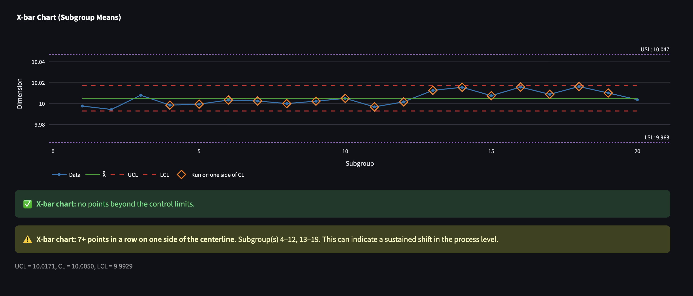
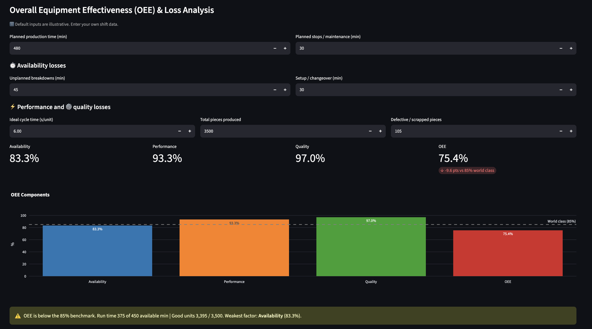
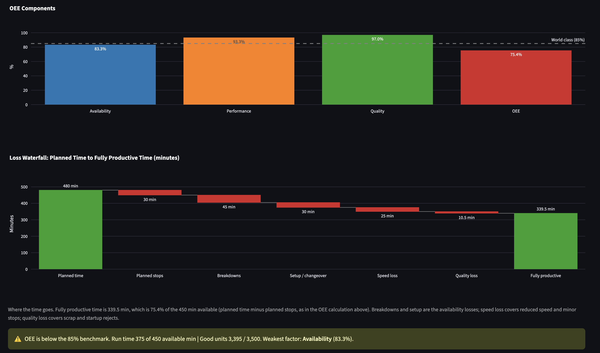
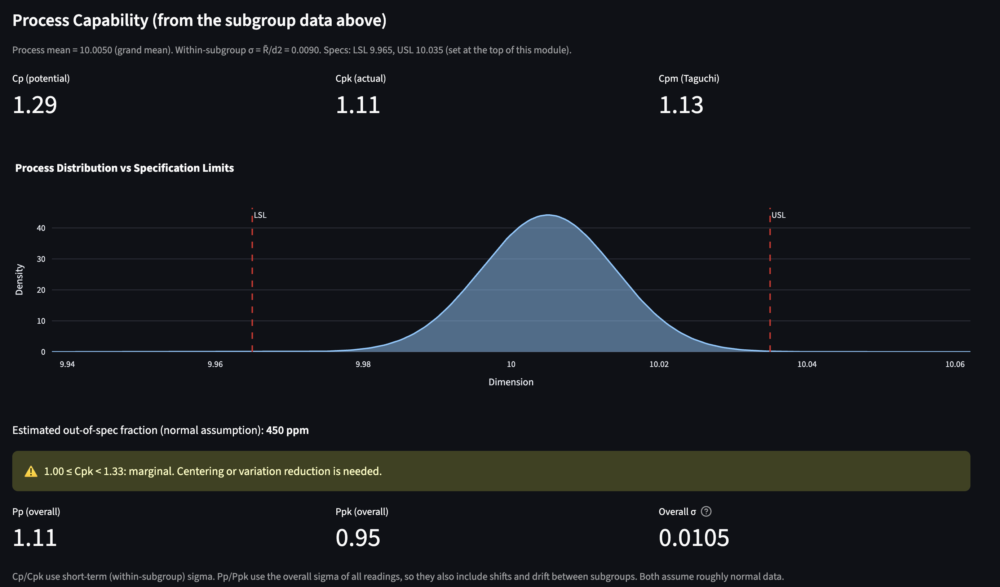

# Manufacturing Operations Command Center 🏭

An interactive, multi-module Streamlit app covering core analyses used in plant quality and operations work: statistical process control, OEE, Pareto analysis, reliability (MTBF/MTTR), line balancing and Six Sigma project tracking. Replace the sample data with your own numbers, or upload a CSV of raw measurements for the SPC charts.

> **All sample data in the app is simulated for illustration**, including the DMAIC project names, owners and savings.

**[▶ Open the live app](https://manufacturing-operations-command-center-qruwsbeh8x9nu6bq5lwnrk.streamlit.app/)** (free hosting: if the app has been idle, the first load can take a few seconds to wake up)


## Try it in a minute

1. Open the **SPC Control Charts** module and expand **Upload your own measurements (CSV)**.
2. Download the example CSV (simulated, with a small process shift after subgroup 12) and upload it back.
3. On the **Variable charts** tab, the X-bar chart flags two runs of points on one side of the centerline, marked with orange diamonds.
4. Set the target to 10.000 and the tolerance to ±0.035 (the example's specification), then open **Process capability**. Ppk (about 0.95) comes out below Cpk (about 1.1) because the overall variation includes the shift that the within-subgroup estimate does not see.



## Problems it solves

| Module | Question it answers | What it computes |
|---|---|---|
| **SPC Control Charts** | Is my process stable, and is it capable of meeting spec? | X-bar, R and S charts with limits from standard SPC constants; points beyond the limits, runs on one side of the centerline and steady trends flagged; Cp, Cpk, Cpm and estimated ppm out of spec; Pp and Ppk from uploaded raw readings; c, u, p and np attribute charts; α/β risk visualization |
| **OEE Dashboard** | Where is this machine losing output? | Availability × Performance × Quality, benchmark vs 85% world class, weakest-factor callout, and a loss waterfall from planned time to fully productive time |
| **Pareto Defects** | Which few defect types drive most of the loss? | Sorted Pareto with cumulative % curve and the "vital few" categories |
| **Maintenance & MTBF** | How reliable is this asset, and what would it take to hit the availability target? | MTBF, MTTR, availability, failure rate, reliability curve, MTBF/MTTR needed to meet target |
| **Line Balancing & Takt** | Can this line meet customer demand? | Takt time, bottleneck, max output vs demand, balance efficiency and delay, stations exceeding takt, theoretical minimum stations |
| **Six Sigma DMAIC Board** | Where is each improvement project in the DMAIC cycle? | Table-driven Kanban board with project metrics |








## Engineering notes

- **Control limits.** X-bar: X̿ ± A₂R̄. R chart: D₃R̄ and D₄R̄. S chart: B₃S̄ and B₄S̄. Constants are for subgroup sizes n = 2 to 10.
- **Run and trend rules.** Besides points beyond the limits, the charts flag 7 or more consecutive points on one side of the centerline and 6 or more consecutive points steadily rising or falling. The lengths are adjustable because conventions differ. A point exactly on the centerline ends a run, and equal consecutive values end a trend.
- **Capability.** Cp and Cpk use short-term (within-subgroup) sigma, estimated as R̄/d₂. Cpk = min(USL − μ, μ − LSL) / 3σ. Pp and Ppk use the overall sample standard deviation of all uploaded readings, so they also reflect shifts and drift between subgroups. Both assume roughly normal data.
- **CSV upload.** Three layouts are supported: one row per subgroup, one row per measurement with a subgroup column, or a single column of readings grouped by a chosen subgroup size. Subgroups must all be the same size (2 to 10 readings). Rows with missing readings are skipped and reported.
- **Attribute charts.** p and u charts handle varying sample size with per-point limits. c and np charts assume a constant sample size and warn otherwise.
- **Pareto.** The "vital few" include the category that carries the cumulative share past 80%. Repeated category names are merged.
- **Takt time.** Net available time ÷ customer demand. Line balance efficiency = total labor content ÷ (stations × bottleneck time).
- **OEE.** Performance is capped at 100%. Planned stops are excluded from available time.
- **OEE loss waterfall.** Fully productive time = available time × OEE, and the bars add up exactly to planned time. Speed loss combines reduced speed and minor stops, and quality loss combines scrap and startup rejects, because the inputs are shift totals.
- **Reliability.** Uptime = scheduled period − repair downtime. MTBF = uptime ÷ failures. The reliability curve assumes a constant failure rate (exponential).

The calculations live in plain Python functions with unit tests, separate from the Streamlit interface.

## Project structure

```
app.py                  Navigation and page setup
modules/
  spc.py, spc_utils.py  SPC interface; pure calculations, run rules and CSV parsing
  oee.py                OEE and loss waterfall
  pareto.py             Pareto analysis
  maintenance.py        MTBF / MTTR
  line_balancing.py     Takt and line balance
  dmaic.py              DMAIC project board
  common.py             Shared chart and table helpers
tests/                  Unit tests and per-module smoke tests (pytest)
docs/screenshots/       Images used in this README
```

## Run locally

```bash
pip install -r requirements.txt
streamlit run app.py
```

Run the tests with `pip install pytest` then `pytest`.

## Limitations

- Sample data is simulated and for illustration only.
- Uploaded data must have equal-sized subgroups (2 to 10 readings each), and the capability indices assume roughly normal data. Uploaded files are processed in the session and are not saved by the app. With an uploaded file, the subgroup summary is read-only; edit the CSV to change it.
- Only the run and trend rules are implemented beyond points outside the limits. The sigma-zone rules (such as 2 of 3 points beyond 2σ) are not.
- OEE inputs are shift totals, not an event log, so speed loss cannot be split into reduced speed and minor stops.
- Data entered in the app is not saved between sessions.

## Roadmap

- CSV upload for the Pareto and OEE modules
- Sigma-zone rules on control charts
- Failure-log import for maintenance analysis, with a downtime Pareto by cause

## Tech stack

Python · Streamlit · Pandas · NumPy · SciPy · Plotly · pytest · deployed on Streamlit Community Cloud
