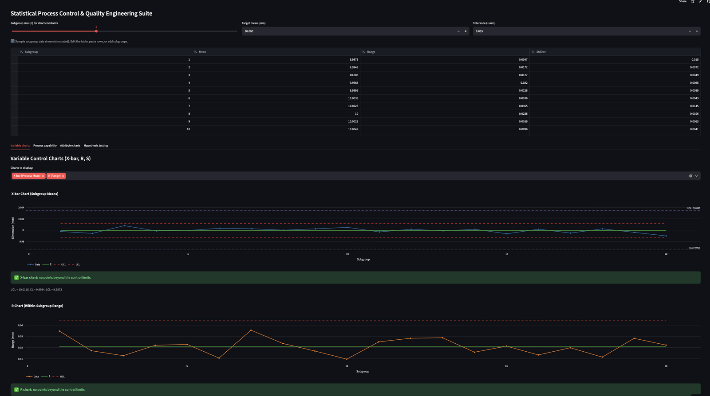
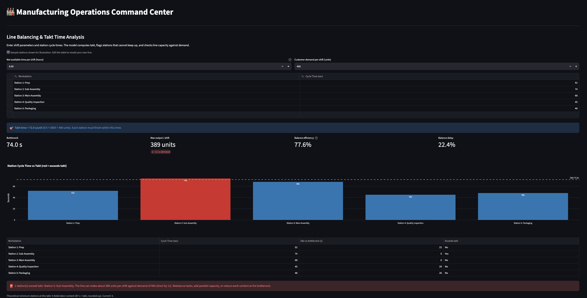

# Manufacturing Operations Command Center 🏭

An interactive, multi-module Streamlit app for the analyses plant and quality engineers run every day: statistical process control, OEE, Pareto analysis, reliability (MTBF/MTTR), line balancing and Six Sigma project tracking. Every table is editable, so you can replace the sample data with your own numbers.

**[▶ Open the live app](https://manufacturing-operations-command-center-qruwsbeh8x9nu6bq5lwnrk.streamlit.app/)** (free hosting: if the app has been idle, the first load can take a few seconds to wake up)



## Problems it solves

| Module | Question it answers | What it computes |
|---|---|---|
| **SPC Control Charts** | Is my process stable, and is it capable of meeting spec? | X-bar, R and S charts with limits from standard SPC constants; out-of-control points flagged; Cp, Cpk, Cpm and estimated ppm out of spec; c, u, p and np attribute charts; α/β risk visualization |
| **OEE Dashboard** | Where is this machine losing output? | Availability × Performance × Quality, benchmark vs 85% world class, weakest-factor callout |
| **Pareto Defects** | Which few defect types drive most of the loss? | Sorted Pareto with cumulative % curve and the "vital few" categories |
| **Maintenance & MTBF** | How reliable is this asset, and what would it take to hit the availability target? | MTBF, MTTR, availability, failure rate, reliability curve, MTBF/MTTR needed to meet target |
| **Line Balancing & Takt** | Can this line meet customer demand? | Takt time, bottleneck, max output vs demand, balance efficiency and delay, stations exceeding takt, theoretical minimum stations |
| **Six Sigma DMAIC Board** | Where is each improvement project in the DMAIC cycle? | Table-driven Kanban board with project metrics |



## Engineering notes

- **Control limits.** X-bar: X̿ ± A₂R̄. R chart: D₃R̄ and D₄R̄. S chart: B₃S̄ and B₄S̄. Constants are for subgroup sizes n = 2 to 10.
- **Capability.** Cp and Cpk use short-term (within-subgroup) sigma, estimated as R̄/d₂. Cpk = min(USL − μ, μ − LSL) / 3σ.
- **Attribute charts.** p and u charts handle varying sample size with per-point limits. c and np charts assume a constant sample size and warn otherwise.
- **Pareto.** The "vital few" include the category that carries the cumulative share past 80%.
- **Takt time.** Net available time ÷ customer demand. Line balance efficiency = total labor content ÷ (stations × bottleneck time).
- **OEE.** Performance is capped at 100%. Planned stops are excluded from available time.
- **Reliability.** Uptime = scheduled period − repair downtime. MTBF = uptime ÷ failures. The reliability curve assumes a constant failure rate (exponential).

The calculations live in plain Python functions with unit tests, separate from the Streamlit interface.

## Project structure

```
app.py                  Navigation and page setup
modules/
  spc.py, spc_utils.py  SPC interface and pure calculation functions
  oee.py                OEE
  pareto.py             Pareto analysis
  maintenance.py        MTBF / MTTR
  line_balancing.py     Takt and line balance
  dmaic.py              DMAIC project board
  common.py             Shared chart and table helpers
tests/                  Unit tests and per-module smoke tests (pytest)
```

## Run locally

```bash
pip install -r requirements.txt
streamlit run app.py
```

Run the tests with `pip install pytest` then `pytest`.

## Limitations

- Sample data is simulated and for illustration only (including all DMAIC project names, owners and savings).
- The SPC variable charts take subgroup summary statistics (mean, range, standard deviation), not raw measurements. Pp/Ppk are therefore not computed.
- Only Rule 1 (points beyond the control limits) is checked; run and trend rules are not yet implemented.
- Data is not saved between sessions.

## Roadmap

- Western Electric / Nelson run rules on control charts
- CSV upload of raw measurements, with Pp/Ppk
- Failure-log import for maintenance analysis

## Tech stack

Python · Streamlit · Pandas · NumPy · SciPy · Plotly · pytest · deployed on Streamlit Community Cloud
