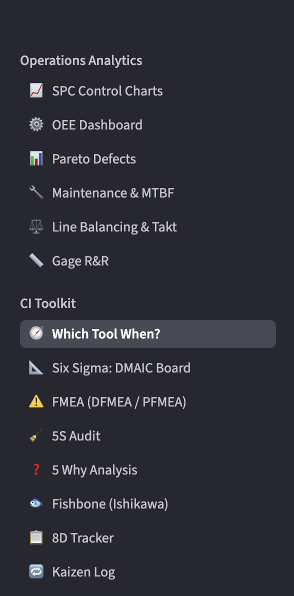
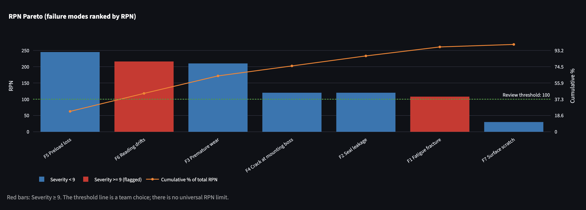
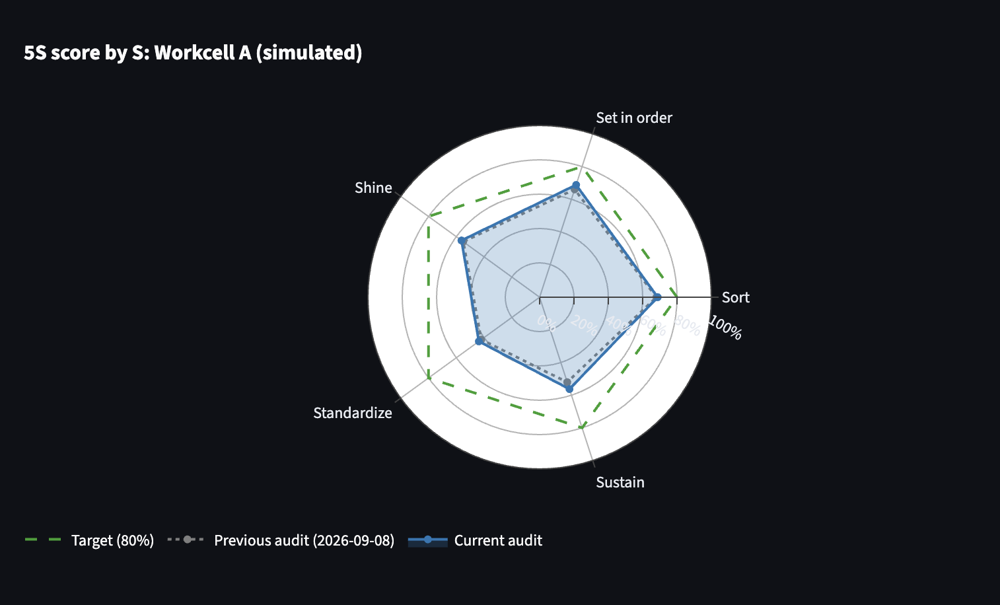
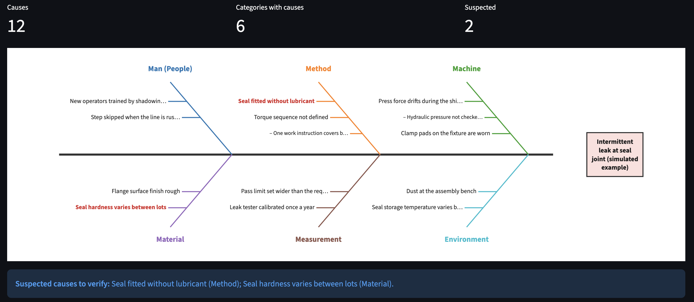
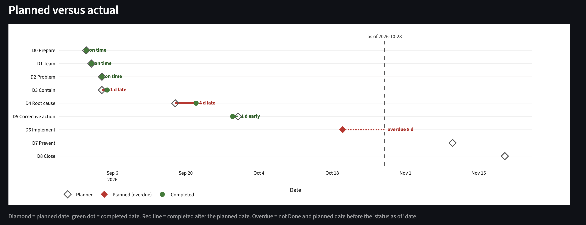
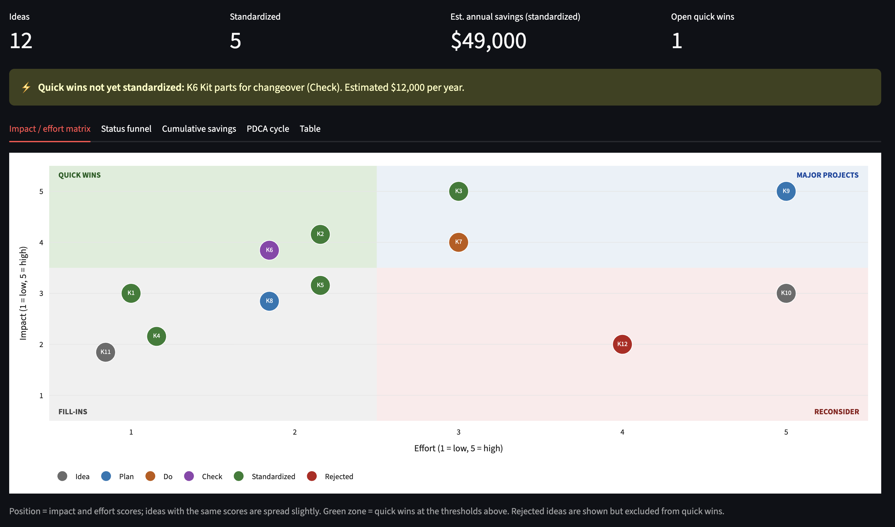
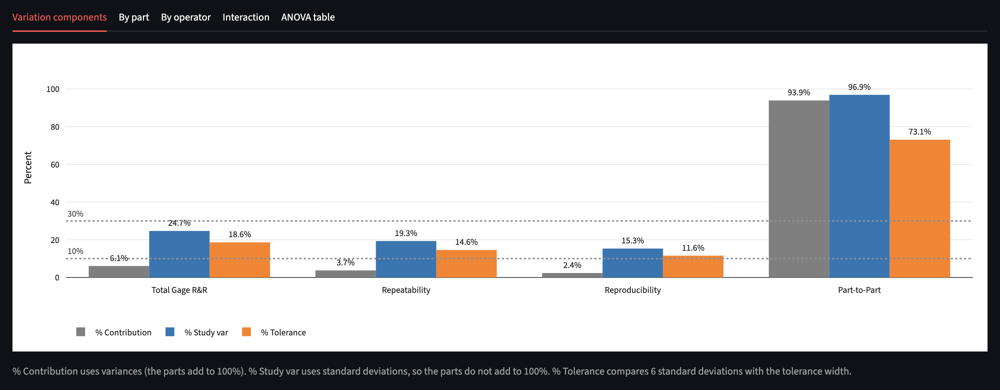
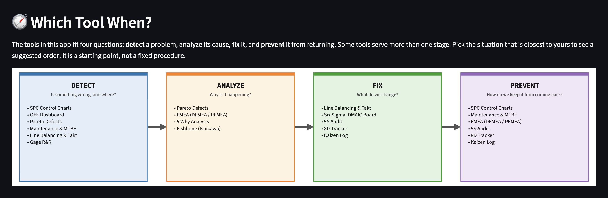

# Manufacturing Operations Command Center 🏭

An interactive, multi-module Streamlit app in two sections. **Operations Analytics** covers core analyses used in plant quality and operations work: statistical process control, OEE, Pareto analysis, reliability (MTBF/MTTR), line balancing and measurement system analysis (Gage R&R). **CI Toolkit** covers continuous-improvement and problem-solving tools: Six Sigma project tracking, FMEA, 5S audit, 5 Why, fishbone, 8D tracker, Kaizen log and a guide to which tool to use when. Replace the sample data with your own numbers, or upload a CSV of raw measurements for the SPC charts and Gage R&R.

> **All sample data in the app is simulated for illustration**, including the DMAIC project names, owners and savings, the FMEA, 5S, 8D and Kaizen examples, and the Gage R&R measurements.

**[▶ Open the live app](https://manufacturing-operations-command-center-qruwsbeh8x9nu6bq5lwnrk.streamlit.app/)** (free hosting: if the app has been idle, the first load can take a few seconds to wake up)




## Try it in a minute

1. Open the **SPC Control Charts** module and expand **Upload your own measurements (CSV)**.
2. Download the example CSV (simulated, with a small process shift after subgroup 12) and upload it back.
3. On the **Variable charts** tab, the X-bar chart flags two runs of points on one side of the centerline, marked with orange diamonds.
4. Set the target to 10.000 and the tolerance to ±0.035 (the example's specification), then open **Process capability**. Ppk (about 0.95) comes out below Cpk (about 1.1) because the overall variation includes the shift that the within-subgroup estimate does not see.


### Try the CI Toolkit

1. Open **Gage R&R**. The simulated study comes out *Marginal* (about 25% of total variation from the gauge). Raise **Repeatability sd** to 0.03 and the verdict becomes *Unacceptable*; set repeatability to 0.0005 and the operator and interaction sd to 0 and it becomes *Acceptable*.
2. Open **FMEA** and read the warning banner: failure modes with Severity of 9 or more are flagged even when their RPN is below the review threshold.
3. Open **Which Tool When?**, pick *A customer complaint arrived* and follow the suggested order of tools.

## Problems it solves

### Operations Analytics

| Module | Question it answers | What it computes |
|---|---|---|
| **SPC Control Charts** | Is my process stable, and is it capable of meeting spec? | X-bar, R and S charts with limits from standard SPC constants; points beyond the limits, runs on one side of the centerline and steady trends flagged; Cp, Cpk, Cpm and estimated ppm out of spec; Pp and Ppk from uploaded raw readings; c, u, p and np attribute charts; α/β risk visualization |
| **OEE Dashboard** | Where is this machine losing output? | Availability × Performance × Quality, benchmark vs 85% world class, weakest-factor callout, and a loss waterfall from planned time to fully productive time |
| **Pareto Defects** | Which few defect types drive most of the loss? | Sorted Pareto with cumulative % curve and the "vital few" categories |
| **Maintenance & MTBF** | How reliable is this asset, and what would it take to hit the availability target? | MTBF, MTTR, availability, failure rate, reliability curve, MTBF/MTTR needed to meet target |
| **Line Balancing & Takt** | Can this line meet customer demand? | Takt time, bottleneck, max output vs demand, balance efficiency and delay, stations exceeding takt, theoretical minimum stations |
| **Gage R&R** | Can I trust the measurements behind these charts? | Crossed ANOVA study: repeatability, reproducibility and part-to-part variation, % study variation, % contribution, % tolerance and distinct categories, with a verdict against the common AIAG guideline limits. A simulator lets you change each source of variation and see the result |

### CI Toolkit

| Module | Question it answers | What it computes |
|---|---|---|
| **Six Sigma DMAIC Board** | Where is each improvement project in the DMAIC cycle? | Table-driven Kanban board with project metrics |
| **FMEA (DFMEA / PFMEA)** | What could fail, and which risks come first? | Classic RPN (Severity × Occurrence × Detection) with a design / process toggle; RPN Pareto, severity × occurrence heat map and before/after RPN bars; Severity ≥ 9 flagged regardless of RPN |
| **5S Audit** | How well is the workplace organised and sustained? | Scored checklist for Sort, Set in order, Shine, Standardize, Sustain; radar chart against a target, trend across audits and a weakest-S callout |
| **5 Why Analysis** | What is the root cause of this problem? | Causal chain from problem to root cause with evidence and a verified flag per level, and a backwards "therefore" logic check |
| **Fishbone (Ishikawa)** | What are the possible causes, by category? | Fishbone diagram built from an editable 6M cause table; suspected causes highlighted |
| **8D Tracker** | Where is this problem report in its steps, and is it on time? | D0 to D8 progress stepper, planned-versus-actual timeline, overdue steps and date-consistency checks |
| **Kaizen Log** | Which improvement ideas should be done first? | Impact/effort matrix with a quick-wins zone, status funnel, cumulative estimated savings and a PDCA cycle diagram |
| **Which Tool When?** | Which tool fits my situation? | Detect / analyze / fix / prevent diagram, situation picker with a suggested order of tools, and a summary table of all tools |
















## Engineering notes

- **Control limits.** X-bar: X̿ ± A₂R̄. R chart: D₃R̄ and D₄R̄. S chart: B₃S̄ and B₄S̄. Constants are for subgroup sizes n = 2 to 10.
- **Run and trend rules.** Besides points beyond the limits, the charts flag 7 or more consecutive points on one side of the centerline and 6 or more consecutive points steadily rising or falling. The lengths are adjustable because conventions differ. A point exactly on the centerline ends a run, and equal consecutive values end a trend.
- **Capability.** Cp and Cpk use short-term (within-subgroup) sigma, estimated as R̄/d₂. Cpk = min(USL − μ, μ − LSL) / 3σ. Pp and Ppk use the overall sample standard deviation of all uploaded readings, so they also reflect shifts and drift between subgroups. Both assume roughly normal data.
- **CSV upload.** Three layouts are supported: one row per subgroup, one row per measurement with a subgroup column, or a single column of readings grouped by a chosen subgroup size. Subgroups must all be the same size (2 to 10 readings). Rows with missing readings are skipped and reported.
- **Attribute charts.** p and u charts handle varying sample size with per-point limits. c and np charts assume a constant sample size and warn otherwise.
- **Pareto.** The "vital few" include the category that carries the cumulative share past 80%. Repeated category names are merged.
- **Takt time.** Net available time ÷ customer demand. Line balance efficiency = total labor content ÷ (stations × bottleneck time).
- **OEE.** Performance is capped at 100%. Planned stops are excluded from available time.
- **OEE loss waterfall.** Fully productive time = available time × OEE, and the bars add up exactly to planned time. Speed loss combines reduced speed and minor stops, and quality loss combines scrap and startup rejects, because the inputs are shift totals.
- **Reliability.** Uptime = scheduled period − repair downtime. MTBF = uptime ÷ failures. The reliability curve assumes a constant failure rate (exponential).

**CI Toolkit and Gage R&R**

- **FMEA.** RPN = Severity × Occurrence × Detection, each a whole number from 1 to 10. The review threshold is set by the user (default 100); there is no universal limit. Any failure mode with Severity ≥ 9 is flagged regardless of RPN. The classic RPN method is used; the AIAG-VDA Action Priority tables are not implemented.
- **5S audit.** Items are scored 0 to 4. S score % = points ÷ (4 × items scored); blank scores are not counted. Overall = average of the five S percentages, so each S counts equally.
- **5 Why.** Row order defines the level and the last row is treated as the root cause. The tool lists checks (few levels, unverified levels) but does not decide whether a cause is a true root cause.
- **Fishbone.** Categories are the 6M: Man (People), Method, Machine, Material, Measurement, Mother Nature (Environment). The diagram lists possible causes only; the Suspected tick marks what the team plans to verify.
- **8D tracker.** Overdue = not Done and planned date before the "status as of" date. Days late = completed minus planned (negative = early). Days open runs to the D8 completion date if D8 is Done, otherwise to the "status as of" date. Step names follow a common convention; organizations differ.
- **Kaizen log.** Impact and effort are whole numbers from 1 to 5. Quick win = impact ≥ the first threshold and effort ≤ the second (defaults 4 and 2), excluding rejected and already standardized ideas. Cumulative savings adds the estimated annual savings of standardized ideas by date standardized.
- **Gage R&R.** Crossed, balanced design analysed by two-way ANOVA. Repeatability = error mean square; operator, interaction and part variance come from mean-square differences, with negative estimates set to 0. The operator × part interaction is removed and pooled with repeatability if its F-test p-value is above alpha (default 0.25, adjustable). Study variation uses 6 standard deviations; distinct categories = floor(1.41 × part sd ÷ gauge sd). Verdict limits (under 10% acceptable, 10% to 30% marginal, over 30% not acceptable, at least 5 categories) are the common AIAG guideline values. The F-distribution p-value is computed in the module and tested against SciPy; sums of squares are tested against an independent calculation, and variance components are recovered from large simulated studies.

The calculations live in plain Python functions with unit tests, separate from the Streamlit interface.

## Project structure

```
app.py                  Navigation (two sidebar sections) and page setup
modules/
  spc.py, spc_utils.py  SPC interface; pure calculations, run rules and CSV parsing
  oee.py                OEE and loss waterfall
  pareto.py             Pareto analysis
  maintenance.py        MTBF / MTTR
  line_balancing.py     Takt and line balance
  gage_rr.py            Gage R&R (ANOVA) and simulator
  dmaic.py              DMAIC project board
  fmea.py               DFMEA / PFMEA (RPN)
  five_s.py             5S audit
  five_why.py           5 Why chain
  fishbone.py           Fishbone diagram
  eight_d.py            8D tracker
  kaizen.py             Kaizen log
  guide.py              Which tool when?
  common.py             Shared chart, table and editor helpers
tests/                  Unit tests and per-module page tests (pytest, Streamlit AppTest)
docs/screenshots/       Images used in this README
```

## Run locally

```bash
pip install -r requirements.txt
streamlit run app.py
```

Run the tests with `pip install pytest` then `pytest`.

## Limitations

- Sample data is simulated and for illustration only.
- Uploaded data must have equal-sized subgroups (2 to 10 readings each), and the capability indices assume roughly normal data. Uploaded files are processed in the session and are not saved by the app. With an uploaded file, the subgroup summary is read-only; edit the CSV to change it.
- Only the run and trend rules are implemented beyond points outside the limits. The sigma-zone rules (such as 2 of 3 points beyond 2σ) are not.
- OEE inputs are shift totals, not an event log, so speed loss cannot be split into reduced speed and minor stops.
- Data entered in the app is not saved between sessions.
- FMEA uses the classic RPN method, not the AIAG-VDA Action Priority tables. RPN has known weaknesses: different S/O/D combinations can give the same RPN, and the product treats ordinal ratings as numbers. The rating-scale text is generic orientation, not a copy of any standard.
- Kaizen savings are annual estimates entered by the user. They are not audited and are not net of implementation cost.
- The 8D tracker follows the steps and dates of one report; it does not store the report's content. The sample uses a fixed "status as of" date so the example looks the same each time.
- Gage R&R covers the crossed ANOVA study only: no nested designs, attribute agreement, bias, linearity or stability studies. Its default data is simulated, and percentages from small studies carry wide uncertainty. It has not been compared with a published worked example.
- Fishbone label widths are fixed, so labels can overlap on a narrow window. The "Which Tool When?" suggestions are generic starting points, and its links open the tool in a new tab.

## Roadmap

- CSV upload for the Pareto and OEE modules
- Sigma-zone rules on control charts
- Failure-log import for maintenance analysis, with a downtime Pareto by cause
- Further lean tools, for example an A3 report and a value stream map

## Tech stack

Python · Streamlit · Pandas · NumPy · SciPy · Plotly · pytest · deployed on Streamlit Community Cloud
